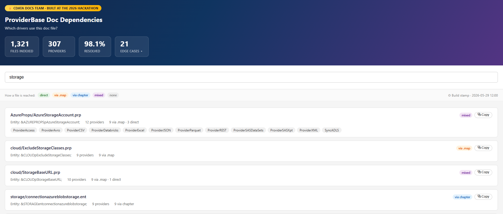

<nav class="site-nav" aria-label="Primary navigation">
  <a class="site-mark" href="./">SL</a>
  

    <a href="./#work">Work</a>
    <a href="./#experience">Experience</a>
    <a href="./#writing">Writing</a>
    <a href="mailto:slindsey001@gmail.com">Email</a>
    <a href="https://www.linkedin.com/in/slindsey001/">LinkedIn</a>
    <a class="nav-resume" href="./assets/Shawn-Lindsey-Resume.pdf">Resume ↗</a>
  

</nav>

<section class="proj-intro">
  <a class="proj-back" href="./#work">← Projects</a>
  <h1>Documentation dependency resolver</h1>
  
A Python tool that answers one question: which driver builds use this shared documentation file? Built at the 2026 CData hackathon.

  <dl class="proj-facts">
    
<dt>Role</dt><dd>Designed and built it</dd>

    
<dt>Tools</dt><dd>Python, HTML, JavaScript</dd>

    
<dt>Scope</dt><dd>1,321 shared files, 307 drivers</dd>

  </dl>
</section>

<section class="home-section">
  <h2>The problem</h2>
  
CData docs are assembled from shared content reused across more than 300 drivers. A shared file reaches a build through layers of includes, entities, chapters, and conditional rules, so "if I change this file, which drivers are affected?" had no quick answer. Finding out took repository-wide searches and about 2 hours of manual tracing.

</section>

<section class="home-section">
  <h2>How it works</h2>
  <ol class="proj-steps">
    <li><strong>Trace references</strong> through bundles, chapter includes, shared maps, and inline entities.</li>
    <li><strong>Evaluate conditions</strong> so edition-specific content only counts where it's actually included.</li>
    <li><strong>Invert the graph</strong> into a lookup from any shared file to the drivers that use it, and how each one gets there.</li>
  </ol>
  
It reads the build's own generated indexes instead of guessing from file names, so every result can be explained.

</section>

<section class="home-section">
  <h2>Using it</h2>
  <pre class="proj-code">$ python doc-deps.py AzureProps/AzureAccessKey.prp
Entity: &amp;AZUREPROPSpAzureAccessKey;
Via:    mixed

Direct body reference (3):
  ProviderDatabricks  SyncADLS  SyncAzureBlobDestination

Via shared .map, marked-section gated (10):
  ProviderAccess  ProviderAvro  ProviderCSV  ProviderExcel
  ProviderJSON  ProviderParquet  ProviderREST  ...</pre>
  
Writers who prefer not to use the terminal get a searchable web version with the same results.

  
</section>

<section class="home-section">
  <h2>Result</h2>
  <dl class="proj-stats">
    
<dd>307</dd><dt>drivers analyzed</dt>

    
<dd>1,321</dd><dt>shared files indexed</dt>

    
<dd>98.1%</dd><dt>of files resolved</dt>

  </dl>
  
A question that took a repository-wide investigation now takes seconds. Conditional content was the hardest part: I checked results against manual repository searches to find missed dependencies, and the tool flags build-generated content as unresolved instead of guessing.

</section>

  <a href="./ai-documentation-agent">← Previous: AI-assisted documentation review agent</a>
  <a href="./#work">All projects →</a>

